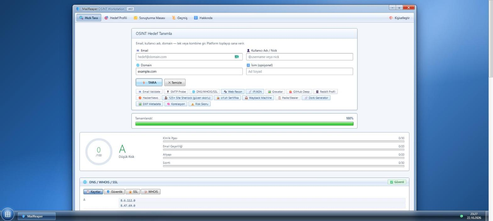
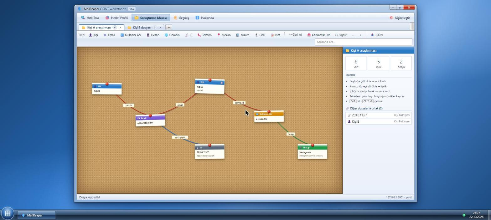
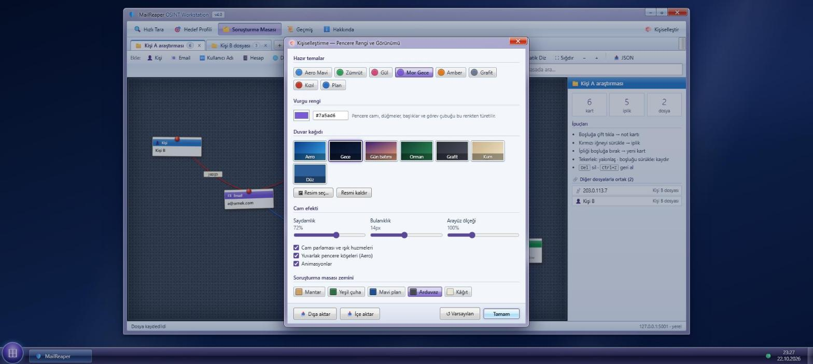

# 🛡️ MailReaper — OSINT Workstation

Windows 7 Aero tarzında, **tamamen yerel çalışan** bir OSINT çalışma masası.
Email, kullanıcı adı, domain ve telefon üzerinden herkese açık kaynakları tarar; bulguları
**soruşturma masasında** (kırmızı iplikli mantar pano) birbirine bağlamanı sağlar.

> *English:* a local-first OSINT workstation with a Windows 7 Aero UI. Parallel scanning
> (no API keys, no bots), a Sherlock-style username search with false-positive filtering, and a
> corkboard-style investigation board with one tab per case file.

| Tarama | Soruşturma Masası | Kişiselleştirme |
|:--:|:--:|:--:|
|  |  |  |

## Özellikler

**Tarama (API anahtarı / bot gerekmez, her şey herkese açık sayfalardan)**
- 📧 Email doğrulama, disposable tespiti, SMTP probe (catch-all, TLS), Gravatar
- 🌐 DNS / WHOIS / SSL, SPF · DMARC · DKIM, crt.sh sertifika şeffaflığı ve subdomain keşfi
- 🛰️ **Web Recon:** teknoloji parmak izi, güvenlik başlığı notu, `robots.txt` / `security.txt`, favicon hash (Shodan uyumlu)
- 📡 **IP / ASN:** A/AAAA, reverse DNS, ASN ve ağ sahibi (yalnızca DNS ile)
- 🕵️ **Sherlock (125+ site):** güven yüzdesi, kategori, soft-404 elemesi; zayıf eşleşmeler "olası" listesinde
- 🐙 GitHub / Reddit / HackerNews derin profil, 🕰️ Wayback Machine, 📋 paste & stealer log kontrolü
- 🎯 Hedef profili: Instagram, X, YouTube, TikTok, Spotify, Steam, Telegram, telefon analizi
- 🖼️ Avatar EXIF analizi, 🔗 dork üretici, 🧠 korelasyon motoru ve risk skoru
- ⚡ Modüller **paralel** çalışır, sonuçlar canlı (SSE) akar

**🗂️ Soruşturma Masası**
- Her kişi / vaka için ayrı **dosya sekmesi**
- 11 kart türü (kişi, email, kullanıcı adı, hesap, domain, IP, telefon, mekan, kurum, delil, not)
- Kırmızı iğneyi başka karta sürükle → **iplik** (tür ve renk seçilebilir)
- Taramadan tek tıkla **📌 Masaya Aktar**, karttan **🔍 Tara**
- Dosyalar arası **ortak öğe** uyarısı, kartı başka dosyaya kopyalama
- Otomatik düzen, yakınlaştırma, arama, geri alma (`Ctrl+Z`), JSON dışa aktarma

**🎨 Kişiselleştirme** — vurgu rengi, hazır temalar, duvar kağıdı (kendi resmin dahil), cam saydamlığı / bulanıklığı,
pano zemini, arayüz ölçeği, animasyonları kapatma, tema dışa/içe aktarma. Masaüstüne sağ tıkla ya da
araç çubuğundaki **Kişiselleştir**'e bas.

## Kurulum

Python **3.10+** gerekir.

```bash
git clone <repo-url> mailreaper
cd mailreaper
python -m venv .venv
# Windows: .venv\Scripts\activate      Linux/macOS: source .venv/bin/activate
pip install -r requirements.txt
python app.py
```

Sonra tarayıcıda **http://127.0.0.1:5001** adresini aç. Windows'ta `start.bat`, Linux/macOS'ta `start.sh` de kullanılabilir.

### Ayarlar (ortam değişkenleri)

| Değişken | Varsayılan | Açıklama |
|---|---|---|
| `MAILREAPER_HOST` | `127.0.0.1` | Dinlenen adres. **Başka bir değere çevirme** — arayüzde kimlik doğrulama yok. |
| `MAILREAPER_PORT` | `5001` | Port |
| `MAILREAPER_DB` | `database/history.db` | Geçmiş ve soruşturma dosyalarının SQLite yolu |

## Veri nerede duruyor?

- Arama geçmişi ve soruşturma dosyaları: `database/history.db` (yerel SQLite)
- Dışa aktarılan raporlar: `exports/`
- Tema ayarları: tarayıcının `localStorage`'ı

`database/` ve `exports/` içeriği `.gitignore` ile repo dışında tutulur; kişisel veriler commit'e girmez.

## Geliştirme

```bash
pip install -r requirements-dev.txt
python -m pytest -q
```

```
app.py              Flask uygulaması, SSE akışı, paralel çalıştırıcı, soruşturma dosyası API'si
modules/            Her OSINT modülü ayrı dosya (username_osint, web_recon, ip_intel, ...)
templates/          Tek sayfa arayüz
static/css/         style.css (Aero tema + değişkenler), board.css (pano)
static/js/          app.js (tarama arayüzü), board.js (masa), theme.js (kişiselleştirme)
tests/              Ağ gerektirmeyen birim/API testleri
```

Yeni modül eklemek için `modules/` altına bir fonksiyon yaz, `app.py` içinde `tasks["adı"] = Task(...)` ile kaydet,
`static/js/app.js` içine bir `render...` fonksiyonu ekle.

## Sorumlu kullanım ⚠️

Bu araç **herkese açık** bilgileri derler; yine de gerçek kişiler hakkında profil çıkarmak hukuki ve etik sorumluluk doğurur.
Yalnızca **kendi hesaplarında, yazılı izin aldığın hedeflerde, güvenlik araştırması / CTF / gazetecilik** gibi
meşru ve yasal amaçlarla kullan. Taciz, takip, doxxing ve izinsiz profilleme kabul edilemez.
Üçüncü taraf sitelerin kullanım şartlarına ve yerel mevzuata (ör. KVKK/GDPR) uymak kullanıcının sorumluluğundadır.
Yazılım "olduğu gibi" sunulur (bkz. [LICENSE](LICENSE)).

Bir güvenlik açığı bulursan lütfen [SECURITY.md](SECURITY.md) içindeki adımları izle.

## Lisans

[MIT](LICENSE)
